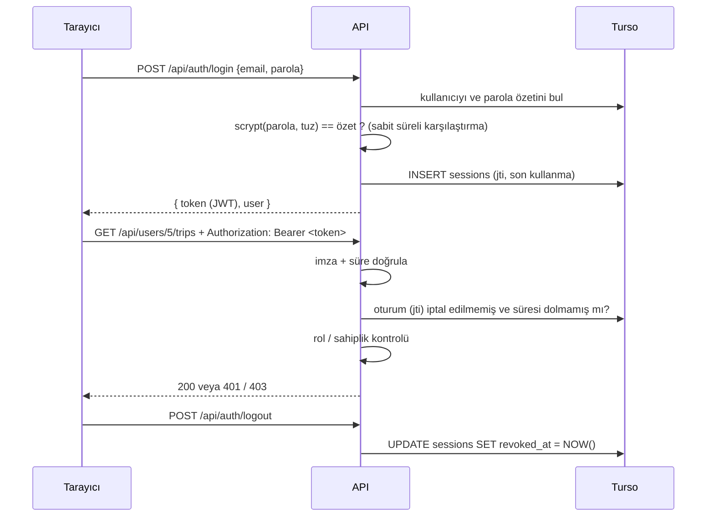

# Güvenlik Notu (Hafta 5)

Bu not, uygulamanın kimlik doğrulama ve yetkilendirme tasarımını, alınan önlemleri ve bilinen sınırları özetler.

## 1. Kimlik doğrulama akışı

## 2. Alınan önlemler

| Tehdit | Önlem | Nerede |
|---|---|---|
| Veritabanı sızarsa parolaların okunması | Parolalar düz metin değil, **kullanıcı başına rastgele tuzlu scrypt** özeti | `utils/password.js` |
| Rainbow table / aynı parolaların fark edilmesi | Her kullanıcıya ayrı 16 baytlık tuz | `utils/password.js` |
| Kaba kuvvet ile parola deneme | 5 hatalı denemede hesap 15 dk kilitlenir, açık oturumları kapatılır | `authService.login` |
| Kullanıcı (e-posta) keşfi | "E-posta yok" ve "parola yanlış" için **aynı mesaj**; olmayan e-postada da sahte özetle aynı süre harcanır | `authService.login` |
| Zayıf parola | En az 8 karakter, harf + rakam (sunucuda zorunlu, arayüzde ipucu) | `passwordProblem` |
| Token sahteciliği / rol yükseltme | HMAC-SHA256 imza; `alg: none` reddedilir; imza sabit süreli karşılaştırılır | `utils/jwt.js` |
| Çalınan token'ın süresiz kullanımı | Token 120 dk geçerli **ve** her istekte oturum kaydı kontrol edilir; çıkışta iptal edilir | `sessions` tablosu |
| Parola değişince eski cihazlar | Parola değişince diğer tüm oturumlar kapatılır | `authService.changePassword` |
| Rol değişikliğinin gecikmesi | Rol token'dan değil, her istekte veritabanından okunur | `authService.authenticate` |
| Kendi kendine yönetici olma | Kayıtta rol istekten okunmaz (hep `gezgin`); rol yalnızca yönetici ucu ile değişir | `register`, `/users/:id/role` |
| Başkasının verisine erişim (IDOR) | Rota/profil işlemlerinde **sahiplik kontrolü**: sahibi değilse 403 | `tripService.loadOwned`, `assertSelfOrAdmin` |
| Gövdeye başka `userId` yazıp onun adına işlem | Rota her zaman giriş yapan kullanıcı adına oluşturulur | `tripService.createTrip` |
| Yönetici kalmaması | Son yönetici silinemez, yönetici kendi yetkisini düşüremez | `userService` |
| Yalnızca arayüzde yetki kontrolü | Tüm kontroller **sunucuda**; arayüzdeki gizleme sadece kolaylık | `middleware/auth.js` |
| SQL enjeksiyonu | Tüm sorgular parametreli (`$1, $2`) | `repositories/` |
| Gizli anahtarın depoya sızması | `JWT_SECRET` yalnızca ortam değişkeninde; üretimde yoksa sunucu başlamaz | `config/env.js`, `.gitignore` |
| Clickjacking, MIME sniffing, önbellekte token | `X-Frame-Options: DENY`, `nosniff`, `Cache-Control: no-store` | `middleware/security.js` |
| Aşırı büyük istek gövdesi | JSON gövde sınırı 100 KB | `app.js` |

## 3. Rol tabanlı erişim matrisi

| Uç | Ziyaretçi | Gezgin | Yönetici |
|---|---|---|---|
| `GET /api/pois`, `/interests`, `/cities` | ✔ | ✔ | ✔ |
| `GET /api/trips/shared/:code` | ✔ | ✔ | ✔ |
| `POST /api/auth/register`, `/login` | ✔ | ✔ | ✔ |
| `GET /api/auth/me`, `POST /logout`, `/password` | 401 | ✔ | ✔ |
| `POST /api/trips` | 401 | ✔ (kendi adına) | ✔ |
| `GET/PATCH/DELETE /api/trips/:id` | 401 | yalnızca kendi rotası, diğerleri 403 | ✔ tümü |
| `GET/PATCH/DELETE /api/users/:id`, `/:id/trips` | 401 | yalnızca kendisi | ✔ tümü |
| `GET/POST /api/users`, `PATCH /api/users/:id/role` | 401 | 403 | ✔ |
| `POST/PATCH/DELETE /api/pois` | 401 | 403 | ✔ |

| Arayüz sayfası | Ziyaretçi | Gezgin | Yönetici |
|---|---|---|---|
| Keşfet `#/` | ✔ | ✔ | ✔ |
| Rotalarım `#/rotalarim` | giriş sayfasına yönlendirilir | ✔ | ✔ |
| Yönetim `#/yonetim` | giriş sayfasına yönlendirilir | 403 sayfası | ✔ |

## 4. Bilinçli tercihler ve bilinen sınırlar

- **scrypt vs bcrypt/argon2:** Üçü de amaca uygun, yavaş "parola özetleme" algoritmalarıdır. scrypt Node.js ile yerleşik geldiği için ek paket gerekmedi. MD5/SHA-256 gibi hızlı özetler parola için uygun **değildir**.
- **Token nerede saklanıyor?** Tarayıcıda `sessionStorage`'da (sekme kapanınca silinir) ve `Authorization` başlığıyla gönderiliyor. Böylece CSRF saldırısı (tarayıcının çerezi otomatik göndermesi) riski yok. Dezavantajı: sayfada bir XSS açığı olursa JavaScript token'ı okuyabilir. React çıktıyı varsayılan olarak kaçışladığı ve `dangerouslySetInnerHTML` kullanılmadığı için risk düşük tutuldu. Daha güçlü alternatif `HttpOnly; Secure; SameSite` çerezdir; ancak frontend ve backend Render'da farklı alt alan adlarında olduğundan üçüncü taraf çerez kısıtlamaları ve CSRF koruması ek iş gerektirir.
- **JWT + sunucu oturumu birlikte:** Saf JWT "durumsuzdur" ve süresi dolana kadar iptal edilemez. Her isteğe küçük bir oturum sorgusu ekleyerek çıkış ve zorla oturum kapatma desteklendi; bedeli istek başına bir indeksli SELECT.
- **Hesap kilitleme kötüye kullanılabilir:** Saldırgan başkasının e-postasıyla 5 kez yanlış deneyip hesabı 15 dk kilitleyebilir. İleride IP bazlı hız sınırlaması (rate limit) ve CAPTCHA eklenebilir.
- **CORS:** Yayında `CORS_ORIGIN` yalnızca frontend adresine ayarlanmalı (`*` bırakılmamalı).
- **Henüz yok:** e-posta doğrulama, parola sıfırlama e-postası, iki adımlı doğrulama, denetim günlüğü (audit log).

## 5. OWASP Top 10 ile ilişki

| OWASP (2021) | Bu projede |
|---|---|
| A01 Broken Access Control | Rol + sahiplik kontrolleri sunucuda, 401/403 ayrımı |
| A02 Cryptographic Failures | Tuzlu scrypt, HMAC imzalı token, gizli anahtar ortam değişkeninde |
| A03 Injection | Parametreli SQL |
| A04 Insecure Design | Son yönetici koruması, kayıtta rol atanamaması |
| A05 Security Misconfiguration | Güvenlik başlıkları, `X-Powered-By` kapalı, üretimde zayıf anahtarla başlamama |
| A07 Identification and Authentication Failures | Parola politikası, kilitleme, genel hata mesajı, oturum süresi ve iptali |
