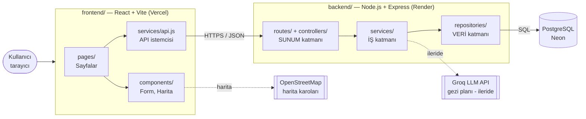
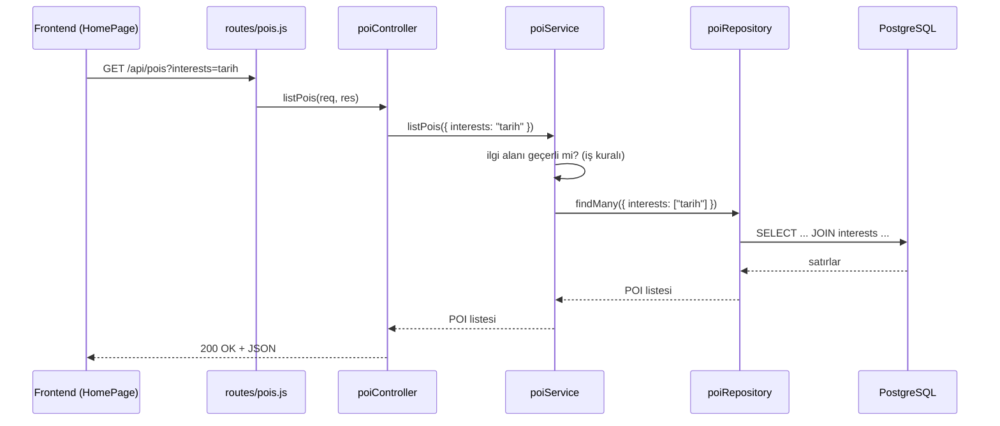

# Mimari Şema

Proje **katmanlı mimari** (sunum / iş / veri) ile kurulmuştur. Frontend ve backend ayrı klasörlerde, ayrı servislerde çalışır ve yalnızca REST API (JSON) üzerinden konuşur.

## Genel görünüm

## Katmanların sorumlulukları

| Katman | Klasör | Ne yapar | Ne yapmaz |
|---|---|---|---|
| **Sunum (API)** | `backend/src/routes`, `backend/src/controllers` | URL'i karşılar, istek parametrelerini okur, JSON yanıt ve HTTP durum kodu döner | İş kuralı içermez, SQL yazmaz |
| **İş (servis)** | `backend/src/services` | Doğrulama, iş kuralları (ör. geçersiz ilgi alanı reddi), ileride rota üretimi ve yapay zekâ çağrısı | HTTP'yi (`req/res`) ve SQL'i bilmez |
| **Veri (repository)** | `backend/src/repositories`, `backend/src/config/db.js` | Parametreli SQL ile CRUD, transaction (`withTransaction`); DB yoksa okumalar seed verisinden | İş kuralı içermez |
| **Sunum (arayüz)** | `frontend/src/pages`, `frontend/src/components` | Ekranlar ve tekrar kullanılabilir bileşenler | Doğrudan `fetch` yapmaz |
| **İstemci servis** | `frontend/src/services` | Backend ile tüm iletişim | Arayüz çizmez |

Bir isteğin akışı (örnek: `GET /api/pois?interests=tarih`):

## Neden katmanlı mimari?

- **Sorumlulukların ayrılması:** Her dosyanın tek bir işi var; hata ararken nereye bakılacağı bellidir.
- **Değiştirilebilirlik:** Veritabanı değişirse yalnızca `repositories/` değişir. Nitekim şu anda DB bağlı değilken repository'ler seed verisinden okuyor ve üst katmanlar bunu fark etmiyor.
- **Test edilebilirlik:** Servisler HTTP'den bağımsız olduğu için tek başına test edilebilir; `app.js` sunucuyu başlatmadan dışa aktarılır.
- **Ölçeklenen proje için uygun:** Rota üretimi ve yapay zekâ gibi karmaşık mantık sonraki haftalarda `services/` altına eklenecek, controller'lar ince kalacak.

**Değerlendirilen alternatifler:** *MVC* (sunucu tarafında görünüm üretir; biz arayüzü ayrı React uygulamasında yaptığımız için uygun değil), *tek dosyada her şey* (küçük projede hızlı ama büyüdükçe yönetilemez — sık yapılan hata), *mikroservis* (bu ölçek için gereksiz karmaşık ve ücretsiz barındırmada birden fazla servis uyku/soğuk başlatma sorunu yaratır).

## Barındırma (tamamen ücretsiz)

| Parça | Servis | Not |
|---|---|---|
| Frontend | Vercel | `frontend/` kök klasör, her push'ta otomatik yayın |
| Backend | Render (Free web service) | `backend/` kök klasör; 15 dk boşta kalınca uyur, ilk istek ~1 dk sürebilir |
| Veritabanı | Neon (Free) | Kalıcı ücretsiz PostgreSQL |
| Harita | OpenStreetMap + Leaflet | Anahtar gerekmez |
| Yapay zekâ | Groq (Free) | Sonraki haftalarda |
