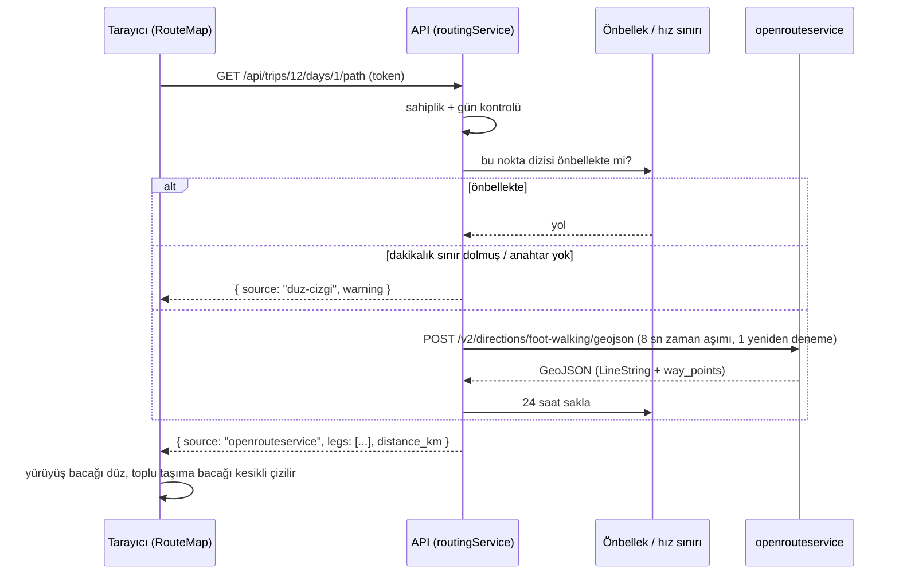

# Harita Entegrasyonu (Hafta 9)

Planlanan günün durakları arasındaki **gerçek yürüme yolunu** harici bir harita servisinden alıp haritada çizer. Servis yoksa ya da hata verirse uygulama yine çalışır: duraklar düz çizgiyle birleştirilir ve kullanıcıya nedeni söylenir.

## Seçilen servis

| | |
|---|---|
| Servis | **openrouteservice** (HeiGIT, Heidelberg Üniversitesi) — OpenStreetMap verisiyle yol hesaplar |
| Uç | `POST https://api.heigit.org/openrouteservice/v2/directions/foot-walking/geojson` |
| Kimlik doğrulama | `Authorization: <ORS_API_KEY>` başlığı (ücretsiz anahtar: account.heigit.org) |
| Ücretsiz sınır | Directions: günde 2000, dakikada 40 istek |
| Neden bu servis? | Ücretsiz, kredi kartı istemiyor, yürüyüş profili var, haritamız zaten OpenStreetMap. Google Directions kart ister; OSRM'nin herkese açık sunucusu yalnızca deneme amaçlı, anahtar/kota yönetimi yok |

> **Not:** Eski adres `api.openrouteservice.org` 24 Kasım 2026'da kapatıldı (410 Gone). Kod yeni adresi kullanıyor; adres `ORS_API_URL` ile değiştirilebilir.

## Akış



## API

| Uç | Erişim | Açıklama |
|---|---|---|
| `GET /api/trips/:id/days/:day/path` | 👤 sahibi/yönetici | Kayıtlı rotanın bir günü (başlangıç noktası dahil) |
| `GET /api/trips/shared/:code/days/:day/path` | 🔓 paylaşım açıksa | Başlangıç (otel) noktası **hariç** |
| `POST /api/routing/path` | 🔑 | Kaydedilmemiş önizleme için `{ points: [{lat,lng}], modes }` |

Yanıt:
```json
{
  "source": "openrouteservice",
  "legs": [ { "mode": "yuruyus", "coordinates": [[41.0086, 28.98], [41.0085, 28.979]], "walk_km": 0.23, "walk_min": 3 } ],
  "distance_km": 0.81, "duration_min": 10
}
```
Yedek durumda: `{ "source": "duz-cizgi", "legs": [...], "warning": "Gerçek yol çizilemedi (harita servisi zamanında yanıt vermedi); ..." }`

## Hata yönetimi

| Durum | Ne olur | Kullanıcı ne görür |
|---|---|---|
| Anahtar tanımlı değil | Servise hiç gidilmez | Düz çizgi + "Harita servisi ayarlı değil" |
| 8 sn içinde yanıt yok | İstek iptal edilir, 1 kez yeniden denenir | Düz çizgi + "zamanında yanıt vermedi" |
| Ağ hatası / 5xx | 1 kez yeniden denenir (400 ms, sonra 800 ms bekleme) | Düz çizgi + "şu anda ulaşılamıyor" |
| 429 (sınır) | `Retry-After` ≤ 2 sn ise bekleyip dener, değilse vazgeçer | Düz çizgi + "istek sınırı doldu" |
| 401/403 | Yeniden denenmez (anahtar yanlış), sunucu kaydına yazılır | Düz çizgi + "anahtarı geçersiz" |
| Bozuk/beklenmeyen yanıt | Ayrıştırılamaz | Düz çizgi + "ulaşılamıyor" |
| Bizim dakikalık sınırımız dolu (30/dk) | Servise gidilmez | Düz çizgi + "N sn sonra yeniden deneyin" |
| Kullanıcı bizim ucumuzu çok çağırırsa (60/dk) | 429 + `Retry-After` | Arayüz hata notu, sekmeye dönünce yeniden dener |
| Şehir dışı / 12'den fazla nokta | 400 | — (arayüz zaten göndermez) |

Önemli karar: **harita servisi hatası rota hatası değildir.** Yol bilgisi süs değil ama planın kendisi (saatler, mesafeler) kendi hesabımızdan geliyor; bu yüzden uç hata yerine 200 + `source: "duz-cizgi"` + `warning` döner.

## Kod

| Dosya | Görev |
|---|---|
| `backend/src/utils/httpClient.js` | `fetchJson`: zaman aşımı, yeniden deneme, 429, hata sınıflandırma; anahtarı mesajlara yazmaz |
| `backend/src/utils/rateLimit.js` | Kayan pencere hız sınırı, Express ara katmanı (429), süreli önbellek |
| `backend/src/services/routingService.js` | Servis çağrısı, GeoJSON → bacaklar, yedek, doğrulama (H1–H6) |
| `frontend/src/components/TripView.jsx` | Gün açılınca yolu bir kez ister |
| `frontend/src/components/RouteMap.jsx` | Bacakları çizer, durum notu |
| `backend/tests/birim/harita.test.js` | 16 test, sahte servisle |
