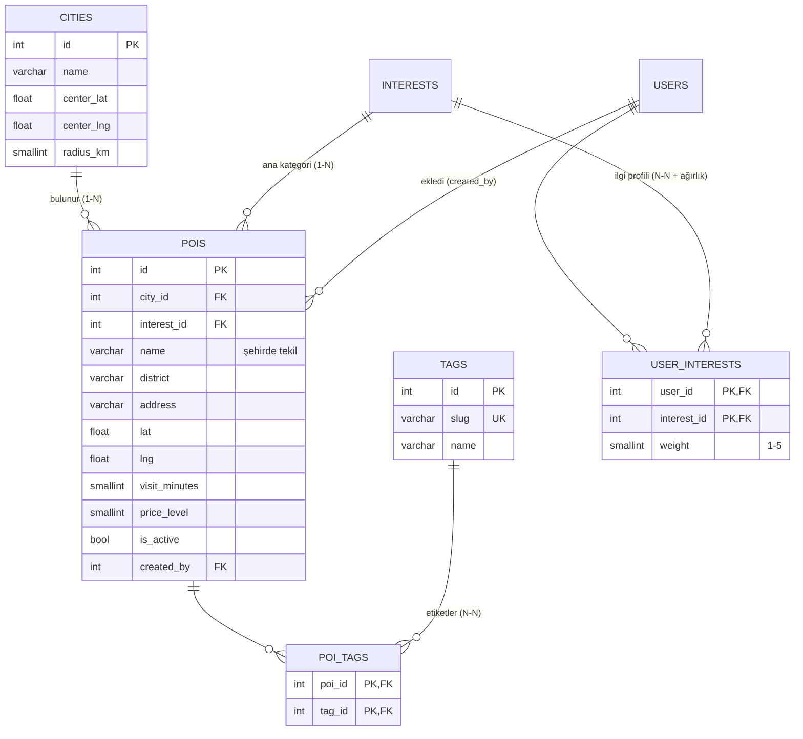

# Çekirdek Modül A: POI Kataloğu ve İlgi Profili

**Ne yapar?** Gezilecek yerleri (POI) kategori, etiket ve konum bilgisiyle yönetir; her kullanıcının ilgi alanlarını ve bu alanlara ne kadar ilgi duyduğunu tutar; ikisini birleştirerek kişiye göre sıralanmış yer listesi üretir. Bu liste, sonraki haftalarda yazılacak **rota üretimi** modülünün girdisi olacaktır.

## Veri modeli



**Kategori ile etiket neden ayrı?** Kategori (`interests`) bir yerin *tek* ana türüdür ve kullanıcının ilgi profiliyle doğrudan eşleşir (Ayasofya → Tarih & Müze). Bu yüzden POI'de bir yabancı anahtar (1-N). Etiket ise birden fazla, serbest özelliktir (Ayasofya → #Tarihi Yarımada, #Kapalı mekân, #Fotoğraflık); bu yüzden ara tabloyla (N-N). "Ücretsiz" bilerek etiket yapılmadı: `price_level = 0`'dan türetilebilen bir bilgiyi ayrıca saklamak tekrarlı veri olurdu.

**İlgi profili neden ağırlıklı?** "Tarihle ilgileniyorum" ile "tarih benim için en önemli şey" aynı değildir. `user_interests.weight` (1–5) ilişkinin kendine ait bir niteliğidir, bu yüzden ara tablodadır.

## İş kuralları

### POI kataloğu (`backend/src/services/poiService.js`)

| Kod | Kural | İhlal edilirse |
|---|---|---|
| K1 | Ad 2–120 karakter; aynı şehirde aynı adlı ikinci POI olamaz (büyük/küçük harf duyarsız; DB'de `UNIQUE (city_id, lower(name))`) | 400 / 409 |
| K2 | Her POI'nin geçerli tek bir kategorisi olmalı | 400 |
| K3 | En fazla 6 etiket, yalnızca tanımlı etiketler; tekrarlar atılır | 400 |
| K4 | Koordinat, şehrin merkezine şehrin hizmet yarıçapından (İstanbul: 60 km) uzak olamaz | 400 + uzaklık bilgisi |
| K5 | Ziyaret süresi 5–600 dk ve 5'in katı; fiyat 0–3 | 400 |
| K6 | Bir gezi planında kullanılan POI silinmez, **pasifleştirilir** (eski planlar bozulmasın) | yanıt: `{ deactivated: true, usedInPlans: n }` |
| K7 | Pasif POI herkese açık listelerde görünmez, yeni rotaya eklenemez; eski rotada "pasif" işaretiyle görünür | 404 / 400 |
| K8 | Yakınlık aramasında yarıçap 0.1–50 km; `lat` ve `lng` birlikte verilmeli | 400 |

### İlgi profili (`backend/src/services/profileService.js`)

| Kod | Kural |
|---|---|
| P1 | Profil yalnızca sahibine aittir: `/api/profile` her zaman giriş yapan kullanıcıyı döndürür (başka kullanıcının id'si verilemez, IDOR imkânsız) |
| P2 | En az 1 ilgi alanı; aynı ilgi iki kez verilemez |
| P3 | İlgi düzeyi 1–5 tam sayı; verilmezse 3 |
| P4 | Bütçe `dusuk/orta/yuksek`, tempo `sakin/normal/yogun` |
| P5 | Öneride bütçeyi aşan yer elenmez, puanı düşer ve gerekçesi yazılır |

### Erişim / sahiplik

| İşlem | Kim |
|---|---|
| POI ve etiket listeleme, POI detayı | Herkes (yalnızca aktif POI'ler) |
| Pasifleri de listeleme (`includeInactive=1`) | Yalnızca yönetici (gezgin gönderse de yok sayılır) |
| POI / etiket ekleme, düzenleme, silme | Yalnızca yönetici (`requireRole`) |
| Profil okuma/güncelleme, "bana uygun" listesi | Giriş yapan kullanıcı, yalnızca kendisi |

## Öneri puanı (entegrasyon)

`GET /api/pois/for-me` profil + katalogu birleştirir. Yalnızca kullanıcının ilgi alanlarındaki aktif POI'ler alınır ve 0–100 arası puanlanır:

```
puan = ilgi düzeyi × 20                 (1/5 → 20, 5/5 → 100)
     − 30   fiyat seviyesi bütçenin üstündeyse   (dusuk: ≤1, orta: ≤2, yuksek: ≤3)
     − 2 × km (en fazla −20)   konum verildiyse
```

Her sonuç neden o sırada olduğunu da taşır: `"reasons": ["Doğa & Park ilgin: 5/5", "bütçene uygun", "0.14 km uzakta"]`.

## Konum araması

PostGIS gerektirmeden iki adımda yapılır (`backend/src/utils/geo.js`):

1. **Kutu ön filtresi** — merkez etrafında `lat BETWEEN … AND lng BETWEEN …`; `(lat, lng)` indeksini kullanır, tablonun çoğunu ucuzca eler.
2. **Kesin mesafe** — kalan satırlarda Haversine formülü; sonuç mesafeye göre sıralanır ve `distance_km` alanıyla döner.

## API

| Metot | Yol | Erişim | Açıklama |
|---|---|---|---|
| GET | `/api/pois` | herkes | Filtreler: `city`, `interests`, `tags` (hepsi), `q` (ad öneki), `priceMax`, `lat`+`lng`+`radiusKm`, `includeInactive` (yönetici) |
| GET | `/api/pois/for-me` | giriş | Profile göre puanlı liste (`lat`, `lng` isteğe bağlı) |
| GET | `/api/pois/:id` | herkes | Tek POI (etiketleriyle) |
| POST / PATCH | `/api/pois`, `/api/pois/:id` | yönetici | Ekle / düzenle (etiketler, `isActive` dahil) |
| DELETE | `/api/pois/:id` | yönetici | Kullanılmıyorsa siler, kullanılıyorsa pasifleştirir |
| GET | `/api/tags` | herkes | Etiketler + aktif POI sayıları |
| POST / DELETE | `/api/tags`, `/api/tags/:slug` | yönetici | Etiket ekle (`"Gün Batımı"` → `gun-batimi`) / sil |
| GET / PUT | `/api/profile` | giriş | İlgi profilini oku / değiştir |

Örnek:

```bash
# Ayasofya çevresi 1 km, mesafeye göre sıralı
curl "localhost:4000/api/pois?lat=41.0086&lng=28.9802&radiusKm=1"
# Boğaz VE gün batımı etiketli yerler
curl "localhost:4000/api/pois?tags=bogaz,gun-batimi"
# Profil güncelle
curl -X PUT localhost:4000/api/profile -H "Authorization: Bearer $TOKEN" -H "Content-Type: application/json" \
  -d '{"budget":"dusuk","pace":"sakin","interests":[{"slug":"doga","weight":5},{"slug":"tarih","weight":2}]}'
```

## Diğer modüllerle entegrasyon

| Modül | Bağlantı |
|---|---|
| Kimlik doğrulama (H5) | Yazma uçları `requireRole('yonetici')`; profil `requireAuth` + "yalnızca kendim"; `created_by` ekleyen yöneticiyi tutar |
| Kullanıcı / kayıt (H5) | Kayıtta seçilen ilgiler profile ağırlık 3 ile yansır |
| Rota (H4) | Rota oluştururken pasif POI reddedilir (K7); eski rotalardaki pasif duraklar `is_active: false` ile görünür |
| Rota üretimi (sonraki haftalar) | `/for-me` puanı ve `visit_minutes`, `distance_km` rota algoritmasının girdisi olacak |
| Arayüz | Keşfet (filtreler, yakınımdakiler, "profilime göre sırala"), Profilim, Yönetim → POI kataloğu |
