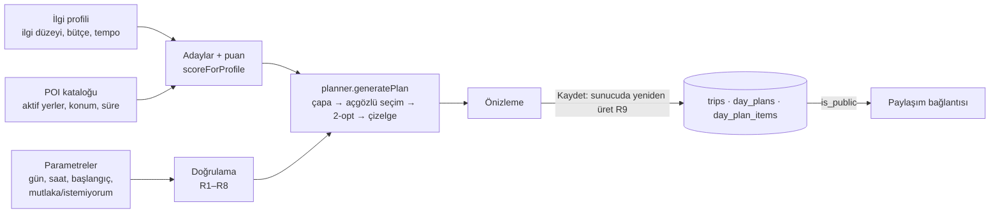
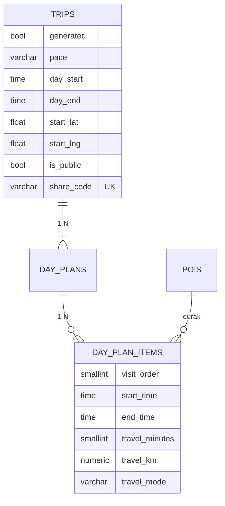

# Çekirdek Modül B: Rota ve Gün Planı Üretimi

**Ne yapar?** Kullanıcının ilgi profilini (Modül A) ve POI kataloğunu alır; gün sayısı, tempo, günün başlangıç/bitiş saati, başlangıç noktası ve "mutlaka / istemiyorum" seçimlerine göre **gün gün, saatli, sıralı** bir gezi planı üretir. Plan önce önizlenir, sonra kaydedilir ve isteğe bağlı olarak bağlantıyla paylaşılır.



## Kod

| Dosya | Görev |
|---|---|
| `backend/src/services/planner.js` | **Çekirdek algoritma.** Veritabanı/HTTP bilmeyen saf fonksiyonlar; tek başına test edilir |
| `backend/src/services/routePlanService.js` | Parametre doğrulama, iş kuralları, aday seçimi, önizleme, kaydetme |
| `backend/src/services/tripService.js` | Sahiplik, paylaşım aç/kapat/yenile, herkese açık görünüm |
| `backend/db/migrations/006_route_generation_sharing.sql` | Yol süresi/mesafe alanları, üretim parametreleri, paylaşım |
| `frontend/src/pages/PlannerPage.jsx` | Ayarlar → önizleme → kaydet |
| `frontend/src/pages/TripDetailPage.jsx`, `SharedTripPage.jsx` | Kayıtlı rota + paylaşım ayarı; herkese açık salt okunur sayfa |
| `frontend/src/components/RouteMap.jsx`, `DayTimeline.jsx` | Gün renkli çizgi + numaralı duraklar; saatli zaman çizelgesi |

## Algoritma

Her gün için dört adım:

1. **Çapa (günün bölgesi):** Kalan en değerli yer seçilir; önceki günlerin çapalarına 3 km'den yakın olanlar cezalandırılır. Böylece her gün farklı bir bölgeye odaklanır (ör. 1. gün Tarihi Yarımada, 2. gün Boğaz).
2. **Açgözlü seçim:** Bulunulan noktadan, kısıtları bozmayan adaylar arasında en yüksek **faydaya** sahip olan eklenir; durak veya kısıt bitene kadar tekrarlanır.
   ```
   fayda = ilgi puanı (0–100)
         + 1000                    zorunlu ("mutlaka") seçildiyse
         − 2 × yol süresi (dk)      uzak yer daha az cazip
         − 8 × çapaya uzaklık (km)  günün bölgesinden çıkma
         − 15 × aynı kategoriden o gün seçilen sayı   (çeşitlilik)
   ```
3. **2-opt iyileştirme:** Durak sırasının bir parçası ters çevrilerek toplam yol kısalıyorsa yeni sıra alınır (zikzak rotaları düzeltir; testte 26,3 km → 10,3 km).
4. **Zaman çizelgesi:** Gün başlangıcından itibaren `yol + ziyaret + tampon` eklenir; saat 12:00–14:00 arasına denk gelen ilk boşlukta 60 dk öğle arası verilir.

**Yolculuk tahmini:** Kuş uçuşu mesafe × 1,3 (yol kıvrımı). ≤ 1,5 km yürüyüş (4,5 km/sa), üstü toplu taşıma (10 dk bekleme + 18 km/sa). Süreler 5 dk'ya yuvarlanır.

**Deterministik:** Aynı katalog ve aynı parametreler → her zaman aynı plan (adaylar puan, sonra kimliğe göre sıralanır). Bu sayede kaydedilen plan önizlemeyle aynıdır (R9).

## Süre ve mesafe kısıtları

| Kısıt | Nasıl uygulanır |
|---|---|
| Gün penceresi (ör. 09:00–19:00) | Her aday denenirken tüm günün çizelgesi yeniden hesaplanır; son durak pencere dışında bitiyorsa aday **eklenmez** |
| Günlük durak sayısı | Tempo: sakin 3, normal 5, yoğun 7 |
| Günlük yol mesafesi | Tempo: 12 / 20 / 30 km; kullanıcı 1–100 km arası değiştirebilir |
| Duraklar arası tampon | Tempo: 15 / 10 / 5 dk |
| Ziyaret süresi | POI'nin `visit_minutes` değeri; durak `end − start` her zaman buna eşit |

72 farklı parametre bileşiminde (3 tempo × 4 gün sayısı × 3 pencere × 2 başlangıç) bağımsız bir doğrulayıcı hiçbir ihlal bulmadı.

## İş kuralları

| Kod | Kural | Neden |
|---|---|---|
| R1 | Üretilen rota 1–7 gün | Algoritma süresi ve kullanılabilirlik |
| R2 | Gün 06:00–23:30 arasında, en az 3 saat; hiçbir durak pencere dışına taşmaz | Gerçekçi gezi günü |
| R3 | Tempo durak/km sınırlarını belirler; verilmezse **profildeki tempo** | Kişiselleştirme (Modül A) |
| R4 | Bir POI bir rotada yalnızca bir kez | Aynı gün: DB `UNIQUE(day_plan_id, poi_id)`; günler arası: serviste |
| R5 | Adaylar yalnızca aktif POI'ler ve kullanıcının ilgi alanlarından; profilde en az 1 ilgi gerekli | Modül A ile tutarlılık |
| R6 | Başlangıç noktası şehrin hizmet alanında olmalı | Yanlış koordinat |
| R7 | En fazla 10 zorunlu yer; aktif ve aynı şehirde; sığmayan gerekçesiyle raporlanır | Kullanıcı neden eksik olduğunu bilmeli |
| R8 | Bir yer hem zorunlu hem hariç olamaz | Çelişkili istek |
| R9 | Kaydedilen plan istemciden alınmaz, sunucuda **yeniden üretilir** | İstemci kısıtları atlatan (ör. 23:00'e taşan) bir plan gönderemez |
| R10 | Yeni rota paylaşıma kapalıdır; yalnızca sahibi açar/kapatır; bağlantı yenilenince eski kod geçersiz olur | Gizlilik |
| R11 | Paylaşılan sayfada sahibin kimliği ve başlangıç noktası (ör. otel) gösterilmez | Gizlilik |

## Veri modeli (eklenenler)



Kısıtlar: `day_end ≥ day_start + 3 saat`, `end_time > start_time`, `start_lat`/`start_lng` ikisi birden ya da hiçbiri, `travel_mode IN ('yuruyus','toplu-tasima')`, `UNIQUE (day_plan_id, poi_id)`.

Üretim parametreleri (`pace`, `day_start`…) rotada saklanır: rotanın hangi ayarlarla üretildiği görülebilir ve ileride "aynı ayarlarla yeniden üret" yapılabilir.

## API

| Metot | Yol | Erişim | Açıklama |
|---|---|---|---|
| POST | `/api/trips/plan` | giriş | Önizleme — kaydetmez |
| POST | `/api/trips/generate` | giriş | Üret + kaydet (`title` zorunlu) |
| POST | `/api/trips/:id/share` | sahibi | `{ isPublic, regenerate }` |
| GET | `/api/trips/shared/:code` | herkes | Yalnızca paylaşım açıksa |

İstek gövdesi (hepsi isteğe bağlı):

```json
{ "city": "İstanbul", "days": 2, "pace": "normal", "dayStart": "09:00", "dayEnd": "19:00",
  "start": { "lat": 41.0369, "lng": 28.985 }, "startDate": "2026-12-10",
  "mustInclude": [15], "exclude": [5], "maxDailyKm": 20 }
```

Yanıt: `params`, `days[]` (her gün `items[]`: `start_time`, `end_time`, `travel_minutes`, `travel_km`, `travel_mode`, `score`, `must`; `lunch`; `totals`; `summary`), `totals`, `warnings[]`, `unplaced[]`.

## Diğer modüllerle entegrasyon

| Modül | Bağlantı |
|---|---|
| A — İlgi profili | Adaylar profildeki ilgilerden; puan `scoreForProfile` ile (ilgi düzeyi, bütçe); tempo varsayılanı profilden |
| A — POI kataloğu | Yalnızca aktif POI; kullanılan POI silinince pasifleşir, kayıtlı rota bozulmaz, durak "artık katalogda yok" görünür |
| H5 — Kimlik/rol | Planlama ve kayıt giriş gerektirir; rota her zaman giriş yapan adına; detay/silme/paylaşım sahiplik kontrollü (403) |
| H4 — Veri erişimi | Rota + günler + duraklar tek transaction'da kaydedilir |
| Sonraki haftalar | Yapay zekâ bileşeni gün özetlerini ve yerel önerileri bu planın üzerine yazacak |
