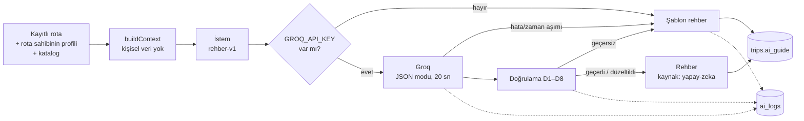

# Yapay Zekâ Bileşeni: Kişisel Plan ve Öneri Üretimi (Hafta 10)

Kaydedilen rotanın her gününü kişinin ilgi alanlarına göre anlatan **kişisel gezi rehberi** ve katalogdan seçilmiş **yerel öneriler** üretir. Model: Groq üzerinde `openai/gpt-oss-20b` (`GROQ_MODEL` ile değiştirilebilir).

## Tasarım kararı: yapay zekâ neyi yapar, neyi yapmaz?

| İş | Kim yapıyor | Neden |
|---|---|---|
| Hangi yerler, hangi gün, hangi sırada, saat kaçta | **Bizim algoritmamız** (`planner.js`, H7) | Kısıtlar (gün penceresi, km, tempo) kesin uygulanmalı ve test edilebilmeli; dil modeli saat/mesafe hesabında güvenilir değil |
| Günü anlatan başlık ve özet, durak başına pratik ipucu | **Yapay zekâ** | Kişiye göre doğal dil üretmek modelin güçlü olduğu iş |
| Plana girmemiş ama sevebileceği yerlerden öneri seçmek ve nedenini yazmak | **Yapay zekâ**, ama yalnızca bizim verdiğimiz **aday listesinden** | Uydurma mekân riski yapısal olarak kapanır |
| Çıktının doğru, güvenli, sınırlar içinde olduğunu kontrol | **Doğrulayıcımız** (`guideValidator.js`) | Model çıktısına körü körüne güvenilmez |
| Yapay zekâ yoksa/çökerse rehber | **Şablon** (`fallbackGuide.js`) | Özellik her zaman çalışır |

## Akış



## Girdi (tercih verisi)

Modele giden veri yalnızca şunlar: şehir, gün sayısı, tempo, bütçe, ilgi alanları ve düzeyleri (ör. "Tarih & Müze 5/5"), plandaki duraklar (ad, tür, semt, saat, ulaşım türü), en fazla 10 öneri adayı (katalogdan; ilgi alanına uyan, aktif, planda olmayan, profile göre en yüksek puanlı).

**Gönderilmeyenler:** ad, e-posta, kullanıcı kimliği, başlangıç (otel) konumu, rota başlığı. Testle doğrulanıyor (`yapay-zeka.test.js` → "istem: … kişisel veri yok").

## İstem (prompt) — `rehber-v1`

**Sistem mesajı** (`backend/src/services/ai/guidePrompt.js`):

```text
Sen İstanbul şehrini iyi bilen, kısa ve somut yazan bir yerel gezi rehberisin.
Görevin: sana verilen HAZIR gezi planını kişinin ilgi alanlarına göre anlatmak, durak başına pratik ipucu yazmak ve
yalnızca "oneri_adaylari" listesinden en uygun en fazla 3 yeri önermek.

KURALLAR
1. Yalnızca VERİ'deki yerlerden söz et. Listede olmayan mekân, restoran, etkinlik veya semt adı UYDURMA.
2. Planı DEĞİŞTİRME: gün, sıra ve saatler aynen kalır; durak ekleme veya çıkarma.
3. Doğrulayamayacağın bilgileri YAZMA: giriş ücreti, fiyat, açılış-kapanış saati, adres, telefon, web adresi.
   Saat yazacaksan yalnızca planda verilen saatleri kullan.
4. Kişiye "sen" diye hitap et; ad veya kişisel bilgi kullanma.
5. Türkçe, sade ve somut yaz. Sınırlar: genel_bakis ≤ 300, baslik ≤ 60, ozet ≤ 280, ipucu ≤ 160, neden ≤ 160 karakter.
6. "neden" alanında önerinin kişinin hangi ilgisine uyduğunu söyle.
7. Yanıtın YALNIZCA aşağıdaki biçimde TEK bir JSON nesnesi olsun; öncesinde/sonrasında açıklama veya markdown olmasın.
{ "genel_bakis": "...", "gunler": [ { "gun": 1, "baslik": "...", "ozet": "...", "ipuclari": [ { "poi_id": 1, "ipucu": "..." } ] } ],
  "oneriler": [ { "poi_id": 1, "neden": "..." } ] }
```

**Kullanıcı mesajı** (kısaltılmış örnek):

```text
VERİ:
{ "sehir": "İstanbul", "gun_sayisi": 2, "tempo": "normal", "butce": "orta",
  "ilgi_alanlari": [ { "ad": "Tarih & Müze", "duzey": "5/5" }, { "ad": "Manzara", "duzey": "4/5" } ],
  "gunler": [ { "gun": 1, "duraklar": [ { "poi_id": 1, "ad": "Ayasofya", "tur": "Tarih & Müze", "semt": "Fatih",
                "baslangic": "09:00", "bitis": "10:15", "ulasim": "ilk durak" }, … ] }, … ],
  "oneri_adaylari": [ { "poi_id": 3, "ad": "Topkapı Sarayı", "tur": "Tarih & Müze", "semt": "Fatih", "aciklama": "…" }, … ] }

Bu plan için kurallara uyan JSON gezi rehberini üret.
```

**İstem tasarımında verilen kararlar**

| Karar | Gerekçe |
|---|---|
| Rol + görev + numaralı kurallar + çıktı şeması | Model neyi, hangi sınırlarla, hangi biçimde üreteceğini tek yerden görür |
| Veriyi JSON olarak vermek, kimlikleri (`poi_id`) istemek | Model mekânı adıyla değil kimliğiyle anar → doğrulayıcı kimliği plan/aday listesinde arayarak uydurmayı yakalar |
| "Fiyat/saat yazma" kuralı | En sık görülen yapay zekâ hatası, kontrol edemediğimiz ve değişen bilgiyi kendinden emin yazması |
| `temperature: 0.4` | Yaratıcılık değil tutarlılık istiyoruz |
| `response_format: json_object` | Groq'un JSON modu; yine de doğrulama yapılıyor çünkü JSON modu şemaya uyumu garanti etmez |
| İstem sürümü (`rehber-v1`) | İstem değişince eski çıktılar ve günlük kayıtları hangi sürümle üretildiği bilinerek karşılaştırılır |

## Çıktı doğrulama (`guideValidator.js`)

| Kod | Kontrol | İhlalde |
|---|---|---|
| D1 | JSON mı? (` ```json ` çiti veya ön/arka metin ayıklanır) | Geçersiz → şablon |
| D2 | Şema ve tipler | Hatalı alan boş sayılır, sorun kaydedilir |
| D3 | Gün numarası planda var mı; eksik gün | Fazla gün atılır, eksik gün şablonla tamamlanır |
| D4 | İpucundaki `poi_id` **o günün** planında mı | Atılır (uydurma yer veya yanlış gün) |
| D5 | Öneri aday listesinde mi, planda değil mi, ≤ 3, tekrarsız | Atılır |
| D6 | HTML, markdown, web adresi; uzunluk sınırı | Temizlenir, sözcük sınırından kısaltılır |
| D7 | Fiyat/ücret (TL, ₺, €, $, "ücretsiz") ya da **planda olmayan saat** içeren cümle | Cümle atılır |
| D8 | Kullanılabilir içerik kaldı mı | Kalmadıysa geçersiz → şablon |

Sonuç durumu: `gecerli` (sorun yok) · `duzeltildi` (sorunlar düzeltildi, kullanıcıya "N sorun bulundu ve düzeltildi" yazılır) · `gecersiz` / `hata` / `ayarsiz` (şablon kullanıldı, nedeni yazılır).

## Örnek çıktı (doğrulanmış, kaydedilen biçim)

```json
{
  "kaynak": "yapay-zeka", "model": "openai/gpt-oss-20b", "durum": "duzeltildi", "istem_surumu": "rehber-v1",
  "uyarilar": ["Yapay zekâ çıktısında 1 sorun bulundu ve düzeltildi."],
  "genel_bakis": "İki gün boyunca Bizans ve Osmanlı izlerini, ardından şehri yukarıdan göreceksin.",
  "gunler": [
    { "gun": 1, "baslik": "Tarihi Yarımada", "ozet": "Sabah Ayasofya ile başlayıp yürüyerek Yerebatan'a geçiyorsun.",
      "ipuclari": [ { "poi_id": 1, "ad": "Ayasofya", "ipucu": "Üst galeriye çıkmayı unutma." } ] }
  ],
  "oneriler": [ { "poi_id": 3, "ad": "Topkapı Sarayı", "semt": "Fatih", "tur": "Tarih & Müze",
                  "neden": "Tarih ilgin yüksek; Ayasofya'ya çok yakın." } ]
}
```
Bu örnekte model 999 numaralı (katalogda olmayan) bir yer önermişti; D5 onu attı ve durum `duzeltildi` oldu. (Birim testindeki senaryo; gerçek model çıktıları `ai_logs.output_excerpt`'te görülebilir.)

## Hatalı / boş çıktı yönetimi

| Durum | Ne olur |
|---|---|
| `GROQ_API_KEY` yok | Modele gidilmez, şablon; "Yapay zekâ servisi ayarlı değil" |
| Zaman aşımı (20 sn), ağ, 5xx, 429 | `httpClient` (H9) 1 kez yeniden dener; sonra şablon + neden |
| Yanıt JSON değil / boş / kesik (`finish_reason: length`) | Geçersiz → şablon; ham yanıt günlüğe |
| Kısmen hatalı (uydurma yer, fiyat, fazla öneri…) | Hatalı kısım atılır, gerisi kullanılır, kullanıcıya bildirilir |
| Kullanıcı çok sık üretirse | 10 dakikada 5'ten sonra 429 |
| Rota planı sonradan değişirse | Eski rehber silinir (yeni plana uymaz) |

## Belgeleme ve şeffaflık

- **Arayüz:** rehberin üstünde her zaman kaynak rozeti: "Yapay zekâ ile üretildi (model) · doğrulandı" veya "Kurallarla hazırlandı (şablon)"; altında "Yapay zekâ hata yapabilir; ziyaret saatlerini ve ücretleri gitmeden kontrol et."
- **`ai_logs` tablosu:** her çağrı için model, istem sürümü ve özeti (SHA-256), durum, süre, token sayısı, bulunan sorunlar, ham yanıtın ilk 4000 karakteri. İstemin kendisi saklanmaz (tercih verisi içerir); özet aynı istemin tekrarlandığını gösterir.
- **Yönetim paneli → Yapay zekâ günlüğü:** son kayıtlar ve durum başına sayı/ortalama süre (`GET /api/ai-logs`, yalnızca yönetici).

## API

| Uç | Erişim | Açıklama |
|---|---|---|
| `POST /api/trips/:id/guide` | 👤 sahibi/yönetici, 5 / 10 dk | Rehber üretir, rotaya kaydeder, döner (201) |
| `GET /api/trips/:id`, `GET /api/trips/shared/:code` | — | `ai_guide` alanında son rehber |
| `GET /api/ai-logs?limit=50` | 🛡️ | Yapay zekâ kullanım günlüğü |

## Kod

| Dosya | Görev |
|---|---|
| `backend/src/services/ai/llmClient.js` | Groq istemcisi (Bearer anahtar, JSON modu, zaman aşımı, hız sınırı) |
| `backend/src/services/ai/guidePrompt.js` | İstem ve sürümü |
| `backend/src/services/ai/guideValidator.js` | D1–D8 |
| `backend/src/services/ai/fallbackGuide.js` | Yapay zekâsız şablon |
| `backend/src/services/ai/guideEngine.js` | Akış: istem → model → doğrulama / yedek (saf, test edilebilir) |
| `backend/src/services/aiGuideService.js` | Y1–Y8, bağlam, kayıt, günlük |
| `backend/db/migrations/007_ai_guide_logs.sql` | `trips.ai_guide`, `ai_logs` |
| `frontend/src/components/TripGuide.jsx` | Rehber kartı, kaynak rozeti |
| `backend/tests/birim/yapay-zeka.test.js` | 14 test, sahte model yanıtlarıyla |
