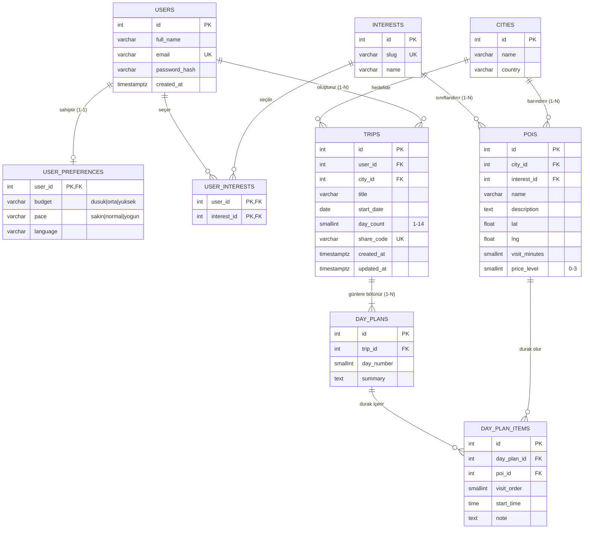

# Veri Modeli ve ER Diyagramı

Şema migration'larla kurulur: [`backend/db/migrations/`](../backend/db/migrations/) · Güncel tam döküm: [`backend/db/schema.sql`](../backend/db/schema.sql)

## ER diyagramı

## Varlıklar

| Varlık | Tablo | Açıklama |
|---|---|---|
| **Kullanıcı** | `users`, `user_preferences` | Gezgin ve bütçe/tempo tercihleri |
| **İlgi** | `interests`, `user_interests` | İlgi alanı kataloğu ve kullanıcının seçtikleri |
| **POI** | `pois`, `cities` | Gezilecek noktalar ve bulundukları şehir |
| **Rota** | `trips` | Kullanıcının bir şehir için oluşturduğu gezi; paylaşım kodu taşır |
| **Gün planı** | `day_plans`, `day_plan_items` | Rotanın her günü ve o günün sıralı durakları |

## İlişki türleri

| Tür | Örnek | Nasıl kuruldu |
|---|---|---|
| **1-1** | Kullanıcı ↔ Tercihler | `user_preferences.user_id` hem PK hem FK; bir kullanıcının en fazla bir tercih satırı olabilir |
| **1-N** | Kullanıcı → Rotalar, Rota → Gün planları, Şehir → POI'ler | "Çok" tarafına FK eklendi (`trips.user_id`, `day_plans.trip_id`, `pois.city_id`) |
| **N-N** | Kullanıcı ↔ İlgi, Gün planı ↔ POI | Ara tablo: `user_interests` (bileşik PK), `day_plan_items` (+ sıra, saat, not) |

## Birincil ve yabancı anahtarlar

- Her bağımsız varlık (`users`, `interests`, `cities`, `pois`, `trips`, `day_plans`, `day_plan_items`) **yapay birincil anahtar** (`SERIAL id`) taşır: ad veya e-posta değişebilir, sayı değişmez; birleştirmeler (JOIN) hızlı olur.
- `user_interests` ayrı bir `id` taşımaz; **bileşik PK** `(user_id, interest_id)` aynı ilginin iki kez eklenmesini engeller.
- `user_preferences` birincil anahtarı olarak `user_id`'yi kullanır; 1-1 ilişkiyi veritabanı seviyesinde garanti eder.
- **Doğal benzersiz anahtarlar** `UNIQUE` ile korunur: `users.email`, `interests.slug`, `trips.share_code`, `(trip_id, day_number)`, `(day_plan_id, visit_order)`.
- `ON DELETE CASCADE`: kullanıcı silinince rotaları, rota silinince gün planları da silinir. POI silinmesi ise plan öğeleri varken engellenir (veri kaybını önlemek için).

## Normalizasyon

- **1NF:** Her hücrede tek (atomik) değer var. İlgi alanları ilk taslakta `profiles.interests TEXT[]` dizisiydi; bu 1NF'yi bozduğu için `user_interests` ara tablosuna taşındı. Bir günün durakları da tek metin alanında değil, `day_plan_items` satırlarında.
- **2NF:** Bileşik anahtarlı tablolarda anahtarın yalnızca bir parçasına bağlı sütun yok. `user_interests` sadece anahtardan oluşur; durak sırası (`visit_order`) gibi bilgiler ancak hem gün planına hem POI'ye bağlı olduğundan `day_plan_items`'ta durur.
- **3NF:** Anahtar olmayan sütunlar arasında geçişli bağımlılık yok. Şehir bilgisi (ad, ülke) POI ve rotalarda tekrar edilmek yerine `cities` tablosuna ayrıldı; ilgi alanı adı POI'de değil `interests`'te tutuluyor. POI'nin şehri değişirse tek bir FK güncellenir.

> Bilinçli istisna: `trips.day_count` gün planı satırlarından türetilebilir, ancak rota oluşturulurken gün planları henüz üretilmemiş olabilir; kullanıcının istediği süreyi saklamak için tutulur.
